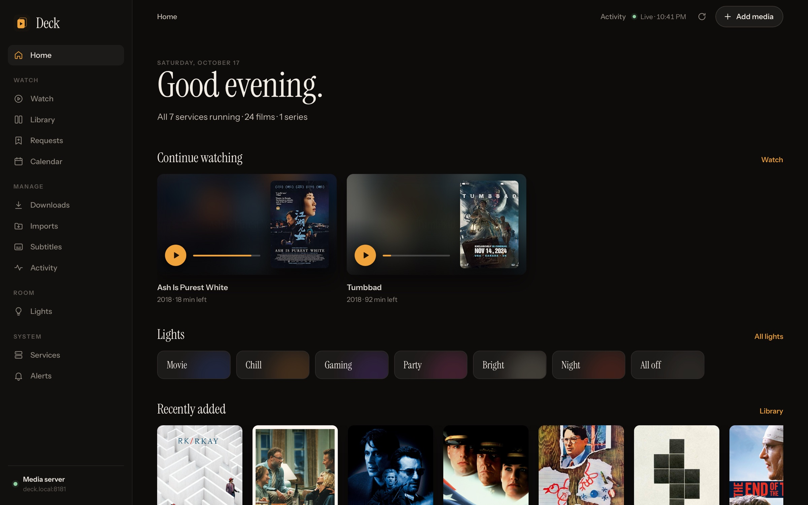
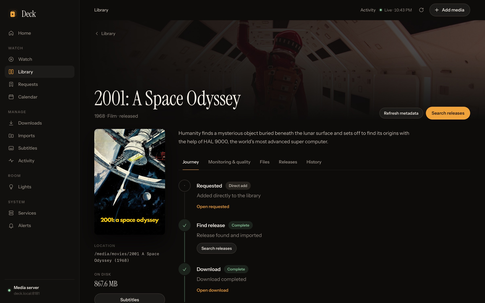
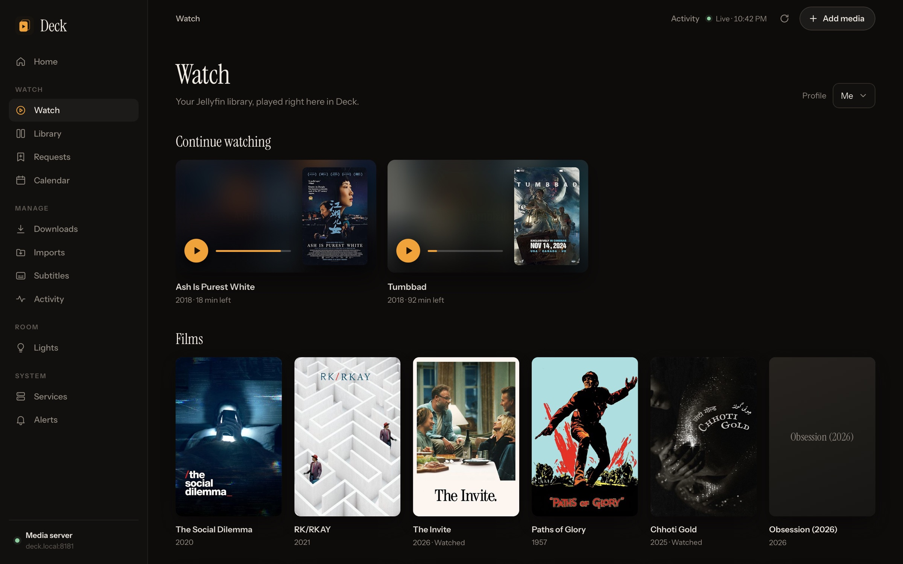
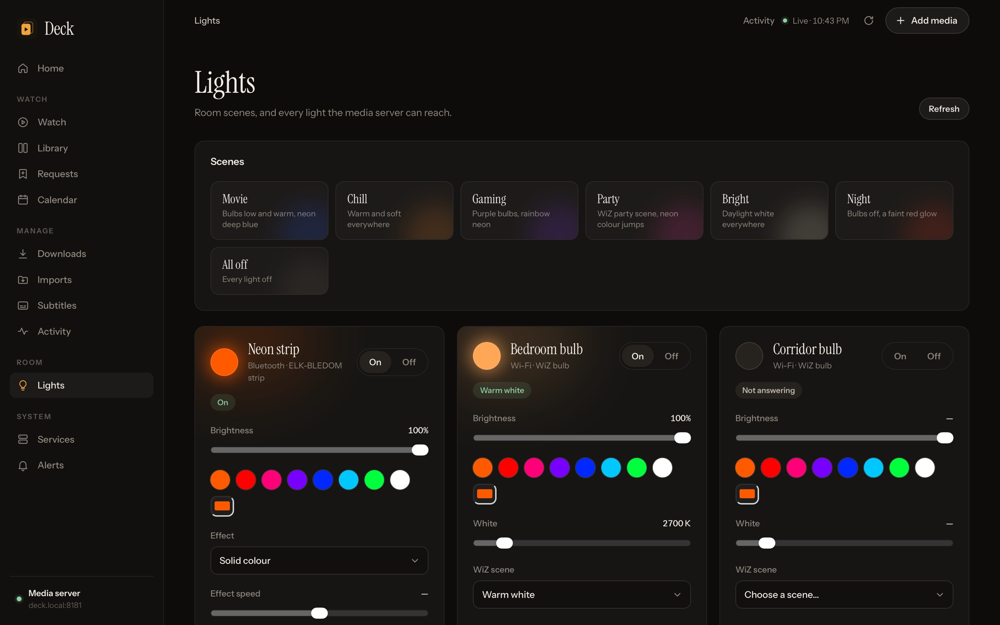
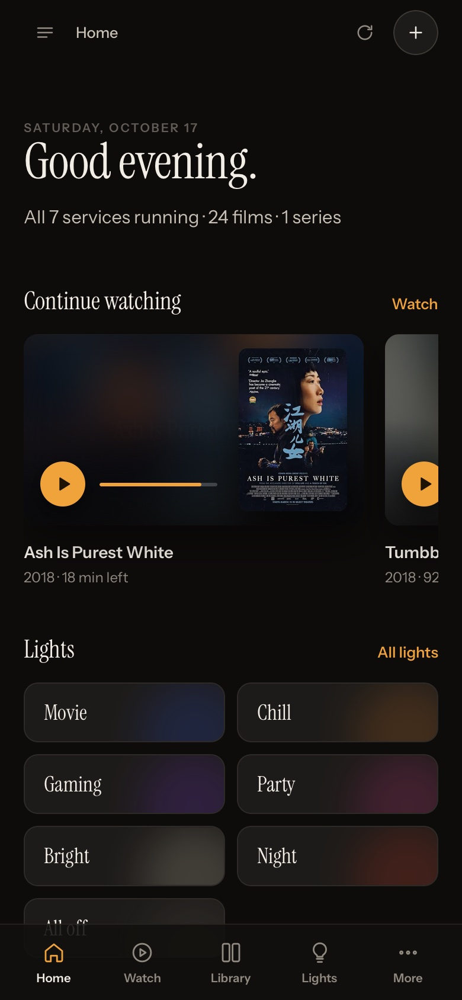

# Deck

A calm, native control room for a home media stack.

Deck puts **Sonarr, Radarr, Prowlarr, Bazarr, qBittorrent, Seerr and Jellyfin** behind one fast interface that works as well on a phone as on a desktop, without embedded admin pages or a second set of logins. It can run the lights in the room too.



## What it does

- **Home.** What you're watching, what's new, what needs attention, and the state of every service, on one page.
- **Every title tells its story.** Request, release, download, import, subtitles and playback appear as one journey, with the evidence and the next useful action at each stage.
- **Watch in the browser.** Jellyfin playback with resume, profiles, and audio and subtitle tracks, as direct play or HLS. The stream is proxied through Deck.
- **Subtitles workbench.** Search your providers, compare matches, download an exact result, edit cues, shift or sync timing, and restore earlier versions.
- **Real management, not links out.** Quality profiles and custom formats, indexers and download clients, manual imports, bulk edits, torrent controls and Seerr requests.
- **Pin a release.** Force-select a specific release for a film and keep automatic upgrades from replacing it.
- **Server-side alerts and monitoring.** Outages, low disk, stalled downloads, blocked imports and failed tasks are tracked even when no browser is open. Up to 24 hours of uptime and throughput history is kept.
- **Room lights (optional).** Scenes and per-light control for WiZ bulbs and Bluetooth LED strips (colours, built-in patterns, music modes from the strip's own mic, sleep timer), through a small bridge.
- **No build step, no dependencies.** Node.js and a browser.

<p>
  
  
</p>
<p>
  
  
  
</p>

## Quick start

You need **Node.js 22.2 or newer** and API keys for your services. Deck expects all seven. One that isn't running shows as unavailable rather than breaking the page.

```sh
git clone https://github.com/sudotman/deck.git
cd deck
cp config.example.json config.json   # add your keys
npm start                             # http://127.0.0.1:8181
```

| Setting | Meaning |
| --- | --- |
| `host` | Where the services run, as seen from Deck. `127.0.0.1` when Deck shares the machine. |
| `bind` / `port` | Deck's listening address and port (default `8181`). Use the machine's LAN address to reach it from other devices. `BIND` and `PORT` environment variables override both. |
| `allowedHosts` | Extra hostnames browsers may use, such as a local DNS name. The machine's own addresses and `localhost` are always allowed. |
| `services.<name>.port` / `.key` | Each service's port and API key. qBittorrent uses `username` and `password` instead. |
| `lights.bridge` | Address of the lights bridge, if you use it. Defaults to `http://127.0.0.1:8183`. |

Where to find the keys: Sonarr, Radarr and Prowlarr under *Settings → General*; Bazarr under *Settings → General → Security*; Jellyfin under *Dashboard → API Keys*; Seerr under *Settings → General*. Keep `config.json` private; it is git-ignored. Deck never sends keys to the browser: every upstream call, image and stream goes through the server.

## Running it on a media PC

Deck runs anywhere Node does. It grew up on a Windows media PC, so the Windows tooling is included:

- **Install.** Put the app in `C:\ProgramData\Deck` with a private copy of `node.exe` in `runtime\` and `windows\run.ps1` beside `server.mjs`. Start `run.ps1` at boot from a scheduled task (the deploy script expects it to be called `Deck Media Dashboard`); it restarts Deck if it ever exits. Allow TCP 8181 from your LAN only.
  ```powershell
  $a = New-ScheduledTaskAction -Execute powershell.exe -Argument '-NoProfile -ExecutionPolicy Bypass -File C:\ProgramData\Deck\run.ps1' -WorkingDirectory C:\ProgramData\Deck
  Register-ScheduledTask 'Deck Media Dashboard' -Action $a -Trigger (New-ScheduledTaskTrigger -AtStartup) -Principal (New-ScheduledTaskPrincipal -UserId 'NT AUTHORITY\LOCAL SERVICE' -LogonType ServiceAccount) -Settings (New-ScheduledTaskSettingsSet -ExecutionTimeLimit 0)
  ```
- **Update.** `npm run package` builds `dist/deck-<version>.zip` with a SHA-256 manifest. Copy it and `windows/deploy-update.ps1` to the PC and run `deploy-update.ps1 -ArchivePath <zip>`. The script verifies checksums, runs the tests with Deck's own Node, waits for running tasks, backs up the current version, swaps the files and rolls back if Deck doesn't come back. `config.json`, `data`, `logs` and `runtime` are left alone.
- **Docker watchdog.** If Seerr runs in Docker Desktop, a Windows Update to WSL can stop Docker's engine without restarting it. `windows/docker-watchdog.ps1` (setup steps are in the file) checks every few minutes and restarts the engine and the container.
- **Network hiccups.** If the network isn't up when Deck starts, it waits for its address instead of crashing.

## Lights (optional)

Deck can drive two kinds of cheap smart lights through `lights-bridge/`, a small Python service:

- **WiZ bulbs** over their local UDP API. Turn on *Allow local communication* in the WiZ app (*Settings → Security*).
- **Bluetooth LED strips** in the ELK-BLEDOM family: the USB neon and LED strips that pair with apps such as *duoCo Strip* or *Lotus Lamp X*. Controllers that advertise as `MELK-…` (addressable "symphony" strips) need `"protocol": "melk"`.

Strip cards have three tabs:

- **Colour.** Swatches and a picker.
- **Pattern.** The controller's built-in animations with speed. MELK controllers also accept raw pattern numbers 0–255 for exploring the unnamed ones.
- **Music.** Rhythm modes 1–8, driven by the controller's own microphone, with mic sensitivity.

Strips also get a sleep timer that the controller runs itself. The commands follow the protocol work in [dave-code-ruiz/elkbledom](https://github.com/dave-code-ruiz/elkbledom) and [l0lsec/LotusLampX](https://github.com/l0lsec/LotusLampX).

Setup:

1. Copy `lights-bridge/devices.example.json` to `devices.json` and list your lights. Bulb MAC addresses are in the WiZ app.
2. On Windows, run `install.ps1` from an elevated PowerShell. It creates a Python environment with `bleak` and starts the bridge at boot as your user, because Bluetooth needs a user context that service accounts lack.
3. Elsewhere, run it directly:
   ```sh
   python3 -m venv .venv && .venv/bin/pip install bleak==3.0.2 && .venv/bin/python bridge.py
   ```

The bridge listens on `127.0.0.1:8183` only, and Deck validates every change before passing it on. Scenes (Movie, Chill, Gaming, Party, Bright, Night, All off) are defined in `lib/lights.mjs`, using the groups `strips`, `bulbs` and `all`.

Things worth knowing:

- **A strip takes one Bluetooth connection at a time.** The bridge releases it after 90 seconds idle so the phone app can connect.
- **Strips can't report their state,** so Deck shows what it last sent.
- **WiZ bulbs only use 2.4 GHz Wi-Fi.** If the computer running the bridge is on 5 GHz and can't reach a bulb ("Destination host unreachable"), pin the bulb's address on Windows (`New-NetNeighbor -InterfaceAlias Wi-Fi -IPAddress <ip> -LinkLayerAddress <mac> -State Permanent`) and reserve that IP in your router.

## Security

Deck has no login of its own: **anyone who can reach it can control your stack.** Keep it on your home network. Bind it to a LAN address, firewall the port, and never forward it to the internet.

Within that, it guards against browser-based attacks:

- Requests must use an expected hostname, which blocks DNS rebinding.
- Writes must come from Deck's own pages.
- Credentials stay on the server, and secrets are redacted from errors.
- A strict Content Security Policy is applied.

## Keeping your own network out of a fork

If you run your fork publicly, keep anything specific to your home (addresses, device IDs, deploy targets, notes) in a git-ignored `home/` folder. That folder can be its own private repository. List the strings that must never be published in `home/private-patterns.txt`, one regular expression per line, then turn on the hooks:

```sh
git config core.hooksPath scripts/hooks
```

Commits and pushes then stop if any of those strings appear in tracked files or commit messages. `npm run check-public` runs the same check by hand.

## Development

```sh
npm test                                              # Node tests against mocked services; never touches real media
cd lights-bridge && python3 -m unittest test_bridge.py # hardware-free bridge tests
```

| Path | Contents |
| --- | --- |
| `server.mjs` | HTTP routes, the authenticated upstream client, overview and monitoring |
| `lib/` | Native actions, jobs, alerts, workflows, imports, subtitles, watch, requests, lights |
| `public/` | The interface: `app.js` (core views), `enhancements.js` (journeys, imports, watch, alerts, configuration), `lights.js`, `style.css` |
| `lights-bridge/` | The Python lights bridge, its Windows installer and tests |
| `windows/` | Supervisor, deploy script and Docker watchdog |
| `scripts/` | Packaging, the public-repo leak check and git hooks |

## Credits

Released under the [MIT License](LICENSE). Bundles [HLS.js](https://github.com/video-dev/hls.js) (Apache-2.0) and the [Instrument Sans](https://github.com/Instrument/instrument-sans) and [Instrument Serif](https://github.com/Instrument/instrument-serif) typefaces (SIL Open Font License). Deck is an independent project and is not affiliated with Sonarr, Radarr, Prowlarr, Bazarr, qBittorrent, Seerr, Jellyfin or WiZ.
