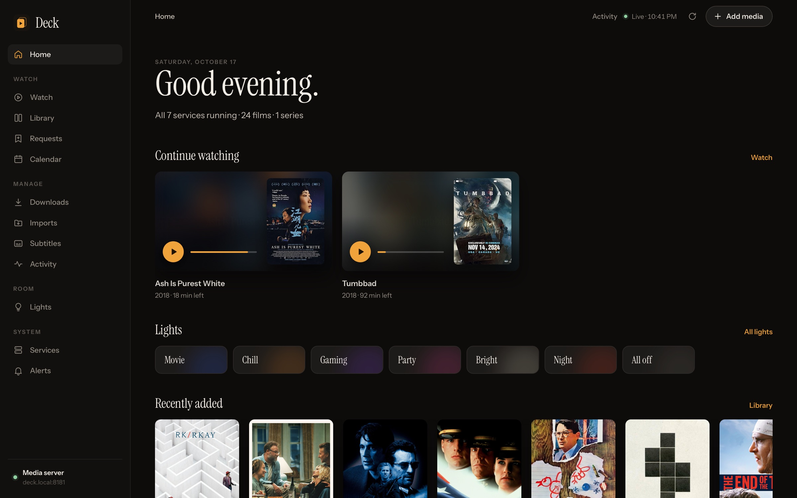
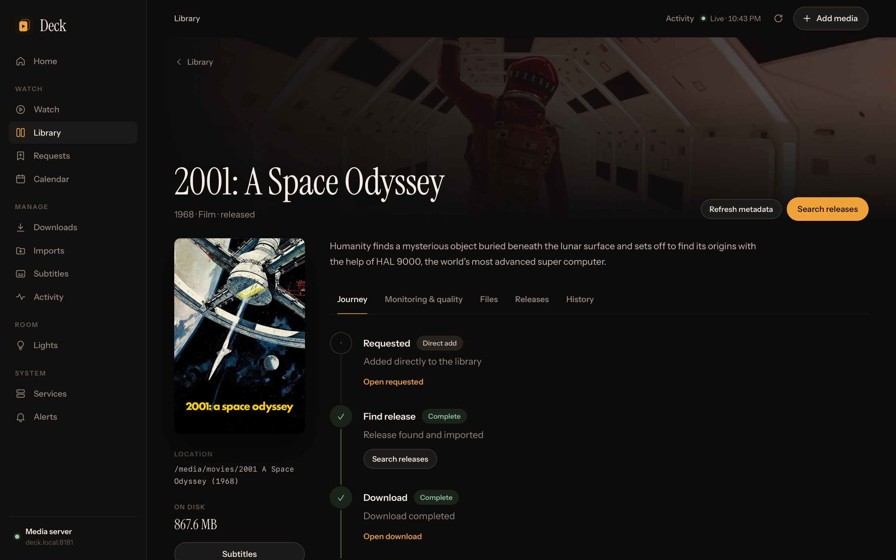
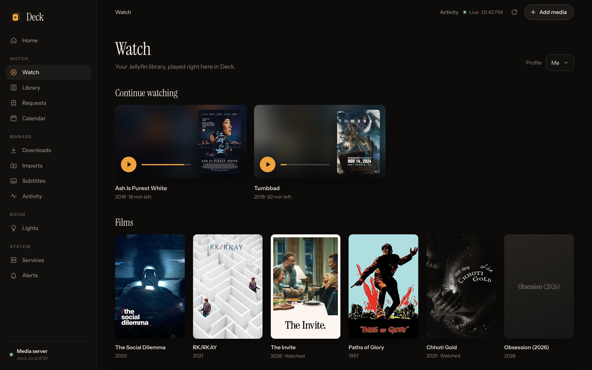
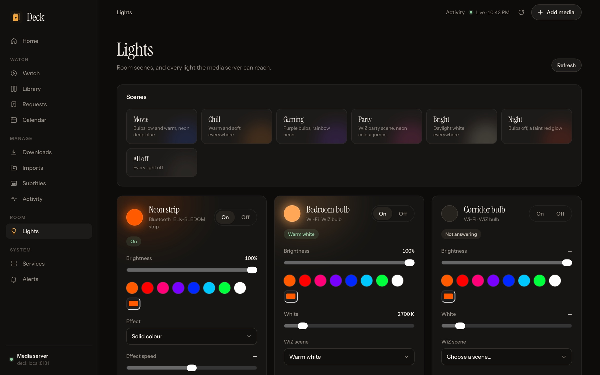
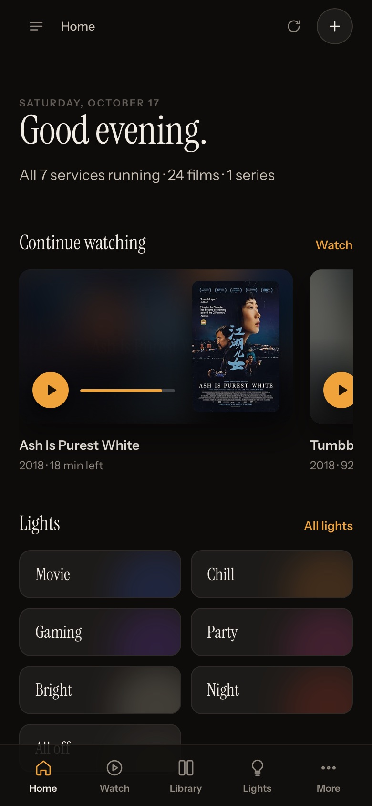
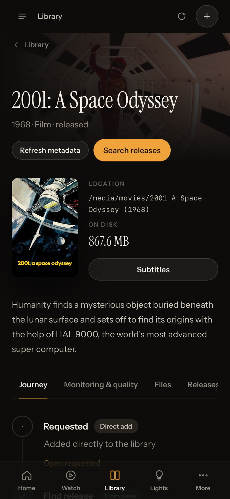

# Deck

A calm, native control room for a home media stack.

Deck puts **Sonarr, Radarr, Prowlarr, Bazarr, qBittorrent, Seerr and Jellyfin** behind one fast interface that works as well on a phone as on a desktop, without embedded admin pages or a second set of logins. It can run the lights in the room too.



## What it does

- **Home.** What you're watching, what's new, what needs attention, and the state of every service, on one page.
- **Every title tells its story.** Request, release, download, import, subtitles and playback appear as one journey, with the evidence and the next useful action at each stage.
- **Watch in the browser.** Jellyfin playback with resume, profiles, and audio and subtitle tracks, as direct play or HLS. The stream is proxied through Deck.
- **Subtitles workbench.** Search your providers, compare matches, download an exact result, edit cues, shift or sync timing, and restore earlier versions.
- **Real management, not links out.** Quality profiles and custom formats, indexers and download clients, manual imports, bulk edits, torrent controls and Seerr requests.
- **Pin a release.** Force-select a specific release for a film and keep automatic upgrades from replacing it.
- **Server-side alerts and monitoring.** Outages, low disk, stalled downloads, blocked imports and failed tasks are tracked even when no browser is open. Up to 24 hours of uptime and throughput history is kept.
- **Room lights (optional).** Scenes and per-light control for WiZ bulbs and Bluetooth LED strips (colours, built-in patterns, music modes from the strip's own mic, sleep timer), finding and naming new bulbs, and wake-up and wind-down schedules Deck runs itself, through a small bridge.
- **No build step, no dependencies.** Node.js and a browser.

<p>
  
  
</p>
<p>
  
  
  
</p>

## Quick start

You need **Node.js 22.2 or newer** and API keys for your services. Deck expects all seven. One that isn't running shows as unavailable rather than breaking the page.

```sh
git clone https://github.com/sudotman/deck.git
cd deck
cp config.example.json config.json   # add your keys
npm start                             # http://127.0.0.1:8181
```

| Setting | Meaning |
| --- | --- |
| `host` | Where the services run, as seen from Deck. `127.0.0.1` when Deck shares the machine. |
| `bind` / `port` | Deck's listening address and port (default `8181`). Use the machine's LAN address to reach it from other devices. `BIND` and `PORT` environment variables override both. |
| `allowedHosts` | Extra hostnames browsers may use, such as a local DNS name. The machine's own addresses and `localhost` are always allowed. |
| `services.<name>.port` / `.key` | Each service's port and API key. qBittorrent uses `username` and `password` instead. |
| `lights.bridge` | Address of the lights bridge, if you use it. Defaults to `http://127.0.0.1:8183`. |

Where to find the keys: Sonarr, Radarr and Prowlarr under *Settings → General*; Bazarr under *Settings → General → Security*; Jellyfin under *Dashboard → API Keys*; Seerr under *Settings → General*. Keep `config.json` private; it is git-ignored. Deck never sends keys to the browser: every upstream call, image and stream goes through the server.

## Running it on a media PC

Deck runs anywhere Node does. It grew up on a Windows media PC, so the Windows tooling is included:

- **Install.** Put the app in `C:\ProgramData\Deck` with a private copy of `node.exe` in `runtime\` and `windows\run.ps1` beside `server.mjs`. Start `run.ps1` at boot from a scheduled task (the deploy script expects it to be called `Deck Media Dashboard`); it restarts Deck if it ever exits. Allow TCP 8181 from your LAN only.
  ```powershell
  $a = New-ScheduledTaskAction -Execute powershell.exe -Argument '-NoProfile -ExecutionPolicy Bypass -File C:\ProgramData\Deck\run.ps1' -WorkingDirectory C:\ProgramData\Deck
  Register-ScheduledTask 'Deck Media Dashboard' -Action $a -Trigger (New-ScheduledTaskTrigger -AtStartup) -Principal (New-ScheduledTaskPrincipal -UserId 'NT AUTHORITY\LOCAL SERVICE' -LogonType ServiceAccount) -Settings (New-ScheduledTaskSettingsSet -ExecutionTimeLimit 0)
  ```
- **Update.** `npm run package` builds `dist/deck-<version>.zip` with a SHA-256 manifest. Copy it and `windows/deploy-update.ps1` to the PC and run `deploy-update.ps1 -ArchivePath <zip>`. The script verifies checksums, runs the tests with Deck's own Node, waits for running tasks, backs up the current version, swaps the files and rolls back if Deck doesn't come back. `config.json`, `data`, `logs` and `runtime` are left alone.
- **Docker watchdog.** If Seerr runs in Docker Desktop, a Windows Update to WSL can stop Docker's engine without restarting it. `windows/docker-watchdog.ps1` (setup steps are in the file) checks every few minutes and restarts the engine and the container.
- **Network hiccups.** If the network isn't up when Deck starts, it waits for its address instead of crashing.

## Lights (optional)

Deck can drive two kinds of cheap smart lights through `lights-bridge/`, a small Python service:

- **WiZ bulbs** over their local UDP API. In the WiZ app's *Settings → Security*, turn on *Allow local communication* with *Allow all controls* (the bridge doesn't sign its messages yet, so *Only verified controls* shuts it out).
- **Bluetooth LED strips** in the ELK-BLEDOM family: the USB neon and LED strips that pair with apps such as *duoCo Strip* or *Lotus Lamp X*. Controllers that advertise as `MELK-…` (addressable "symphony" strips) need `"protocol": "melk"`.

Strip cards have three tabs:

- **Colour.** Swatches and a picker.
- **Pattern.** The controller's built-in animations, with speed. MELK controllers get all 213 of theirs, grouped by family and named as in the vendor's phone app.
- **Music.** The eight visualisers on the remote's music buttons (Energetic, Rhythm, Spectrum and Rolling, plus a second version of each), driven by the controller's own microphone, with mic sensitivity.

Strips also get a sleep timer that the controller runs itself. The commands follow the protocol work in [dave-code-ruiz/elkbledom](https://github.com/dave-code-ruiz/elkbledom), [l0lsec/LotusLampX](https://github.com/l0lsec/LotusLampX) and [ilyakurdyukov/btgadget](https://github.com/ilyakurdyukov/btgadget). The MELK pattern and visualiser tables come from the vendor app decompiled in [wxx9248/Corner-Floor-Lamp-Controller](https://github.com/wxx9248/Corner-Floor-Lamp-Controller).

Setup:

1. Copy `lights-bridge/devices.example.json` to `devices.json` and list your strips. Bulbs can go in by hand too, but it's easier to add them from Deck: *Lights → Find lights* sweeps the network for WiZ bulbs that aren't listed, says what each one is (colour, tunable white, dimmable or plug), blinks one on request, and saves the ones you name to `devices.json`.
2. On Windows, run `install.ps1` from an elevated PowerShell. It creates a Python environment with `bleak`, opens UDP 38900 for WiZ updates on private networks, and starts the bridge at boot as your user, because Bluetooth needs a user context that service accounts lack. If Deck has changed the installed `devices.json` since your copy, the installer keeps the installed one.
3. Elsewhere, run it directly:
   ```sh
   python3 -m venv .venv && .venv/bin/pip install bleak==3.0.2 && .venv/bin/python bridge.py
   ```

The bridge listens on `127.0.0.1:8183` only, and Deck validates every change before passing it on. Scenes (Movie, Chill, Gaming, Party, Bright, Night, All off) are defined in `lib/lights.mjs`, using the groups `strips`, `bulbs` and `all`. A bulb in another room (a kitchen light, say) can set `"scenes": false` in `devices.json`: it keeps its own controls and goes off with *All off*, but the mood scenes leave it alone. Some bulbs sleep their Wi-Fi while switched off and miss most messages (Deck says a light "did not respond" but it changed anyway, or it doesn't change at all): give such a bulb `"timeout": 10` (or set *Keep trying for* in the bulb's *Settings*) and the bridge repeats each message every second for up to that long, until the bulb answers.

The bridge registers with each bulb every 20 seconds, the way the WiZ app does, and the bulbs push every change to it on UDP 38900. So the page shows a change made from the WiZ app or a remote straight away, a bulb that changed but whose reply was lost is reported as changed, and a bulb that restarts on a new address is found as soon as it announces itself (no subnet sweep). If the bridge can't listen on that port, it asks each bulb instead, as before. It also asks each bulb what it can do, so a white bulb has no colour swatches, its white slider covers its own range, and a colour step in a scene only sets its brightness. *Identify* on a bulb's card blinks it three times and puts it back.

**Schedules.** Deck runs schedules itself, so routines don't need the WiZ app or its cloud: set a scene at a time, *Wake up* (a fade from a faint warm glow to daylight over 1 to 90 minutes), or *Wind down* (dims each light that's on from where it is, warmer, then off). They're kept in `data/light-schedules.json`. Changing the lights yourself stops a fade in progress.

Things worth knowing:

- **A strip takes one Bluetooth connection at a time.** The bridge releases it after 90 seconds idle so the phone app can connect.
- **Strips can't report their state,** so Deck shows what it last sent.
- **New bulbs still need the WiZ app once,** to join your Wi-Fi. After that Deck can find them. Firmware updates also come only through the app.
- **WiZ bulbs only use 2.4 GHz Wi-Fi.** If the computer running the bridge is on 5 GHz and can't reach a bulb ("Destination host unreachable"), pin the bulb's address on Windows (`New-NetNeighbor -InterfaceAlias Wi-Fi -IPAddress <ip> -LinkLayerAddress <mac> -State Permanent`) and reserve that IP in your router.

## Letterboxd watchlist (optional)

Set `letterboxd.user` (a public profile) in `config.json`, and `GET /hub/api/watchlist?count=12` returns random films from that watchlist. Artwork (a 1080p backdrop and a poster), synopsis, director, runtime and the TMDB id come from each film's Letterboxd page and are cached in `data/watchlist.json`; library state (`available`, `requested`, `missing`) comes from Radarr. When Seerr can reach TMDB, films not in the library also list the subscription services they stream on in `letterboxd.region`. The list itself is re-read twice a day.

`GET /hub/api/watchlist/tonight` returns tonight's film: one pick per night (until 5 am), kept in `data/watchlist.json`, so every screen agrees and a restart doesn't reshuffle it. `POST` it `{ "next": true }` for another (films already offered tonight aren't repeated) or `{ "slug": "…" }` to choose one; add `"show": true` to have the TV show it straight away. `GET /hub/api/watchlist/films?q=` searches the watchlist for a picker.

Tonight's film also carries `stremio`: what Stremio's addon (Torrentio by default) offers for it, checked ahead of time from the film's IMDb id. The best source is the highest resolution with enough seeders; `good` means 1080p or better with at least 15. Set `stremio.addon` (an addon's base URL), `stremio.minSeeders`, or `stremio.enabled: false` in `config.json` to change it.

## Advert subtitles

Some releases (YTS/YIFY above all) ship a tiny `.srt` that is only an advert ("Provided by YTS…"). Bazarr counts it as a subtitle and never looks for a real one. When Radarr imports a film, its webhook tells Deck (`POST /hub/api/hooks/radarr?key=…`, on import and upgrade; the key is in Deck's private `data/radarr-hook-key`), and Deck checks that film's subtitles once Bazarr has indexed it, retrying for up to 45 minutes. A subtitle counts as an advert only if every line in it is advert text, so real subtitles with a credit line or two are left alone. An advert is backed up (restorable from the title's subtitles page), removed through Bazarr, and replaced by Bazarr's automatic search. `GET /hub/api/subtitle-adverts` lists any it can see.

## Subtitles in Stremio

Stremio's OpenSubtitles addon knows each subtitle's file name and release group, but Stremio drops them: the TV lists subtitles by bare id in no useful order and picks whichever comes first. Deck serves a subtitles addon in front of it. Install `http://<deck>/hub/stremio/manifest.json` in Stremio (and remove *OpenSubtitles v3*, so its unnamed copies don't race Deck's). For each film or episode it asks OpenSubtitles with the hash and file name Stremio sends, then ranks the answer against the file being played: OpenSubtitles' own hash match first, then the same release group, the same source (WEB-DL and WEBRip count as one), the same edition and resolution; subtitles split in parts (CD1/CD2) go last. Each language keeps its eight best, named like "Same release · AMIABLE BluRay 1080p".

## TV companion

Open **/hub/tv** on a phone to send things to the Vitrine launcher on the TV: choose tonight's film, play a link (YouTube links open in YouTube), or search YouTube. Sends go to `POST /hub/api/tv/send` (`{ "kind": "link", "url" }`, `{ "kind": "search", "text" }`); the TV long-polls `GET /hub/api/tv/events?epoch=&after=`. Sends live in memory for two minutes, so nothing queued turns up on the TV hours later.

**Waking the TV.** With `"tv": { "address": "192.0.2.42:5555" }` (the TV's wireless ADB address) in the lights bridge's `devices.json`, the phone page shows whether the TV is on and a button to wake it or send it to standby (`GET`/`POST /hub/api/tv/power`, `{ "action": "wake" | "sleep" }`). It uses ADB, which keeps answering in standby, the way [Relay](https://github.com/sudotman/tvrelay) does. The bridge runs it rather than Deck because the bridge runs as you, and the TV trusts your ADB key once Relay is paired; Relay's bundled `adb` is used when it's installed (or set `"adb"` under `"tv"`).

**Tonight on YouTube.** Tonight's film is also looked for on YouTube in full (older and independent films often are), by any of its Letterboxd titles. A video only counts when its title names the film, says it's the whole film ("full movie", the year or the director), runs about as long, isn't a review, podcast or trailer, and plays here; recent films only count from verified channels, since free uploads of new releases are nearly always fakes. Matches show as "On YouTube in full" with a Play on YouTube button on the TV.

**Films you've watched.** For the wall's runs of film stills, `GET /hub/api/diary?count=24` gives a sample of the films you've rated 3★ or more, weighted toward favourites, each with its still, director, the date you last watched it, your rating in half-stars, and whether you liked or rewatched it. Letterboxd's RSS carries only the latest 50 diary entries (older diary pages sit behind a bot check), so Deck keeps every entry it sees in `data/diary.json`. For everything before that, unzip a [Letterboxd export](https://letterboxd.com/settings/data/) into `data/letterboxd-export` (`diary.csv`, `ratings.csv` and `likes/films.csv` are read) and restart Deck.

**Your YouTube.** The TV's own YouTube row is published signed out, so Vitrine's YouTube room uses your subscriptions instead: on the phone page, choose `subscriptions.csv` from [Google Takeout](https://takeout.google.com) (YouTube → subscriptions only), or sign in with a code. Signing in needs a Google Cloud OAuth client of type *TVs and Limited Input devices* with the YouTube Data API enabled, in `config.json` as `"youtube": { "clientId": "…", "clientSecret": "…" }`; the list is then re-read daily. New uploads come from each channel's public feed (no key, no quota), newest first, Shorts left out, two per channel at most: `GET /hub/api/youtube?count=14`. The list and any sign-in token are kept in `data/youtube.json`.

When Radarr's import webhook reports a new film (not an upgrade), Deck keeps it in `data/arrivals.json` for three days and nudges the TV, which announces it on the art ("Central Station is in your library"). `GET /hub/api/arrivals` lists the ones not yet dismissed; the TV dismisses each with `POST /hub/api/arrivals/dismiss` `{ "id": <Radarr id> }` once it's played or waved away.

`POST /hub/api/watchlist/request` with `{"tmdbId": 21450}` adds the film to Radarr and searches for it, as a normal Deck job. It uses `letterboxd.root` and `letterboxd.profile` (an id or name) when set, otherwise the first root folder and a 720p/1080p profile.

## Security

Deck has no login of its own: **anyone who can reach it can control your stack.** Keep it on your home network. Bind it to a LAN address, firewall the port, and never forward it to the internet.

Within that, it guards against browser-based attacks:

- Requests must use an expected hostname, which blocks DNS rebinding.
- Writes must come from Deck's own pages.
- Credentials stay on the server, and secrets are redacted from errors.
- A strict Content Security Policy is applied.

## Keeping your own network out of a fork

If you run your fork publicly, keep anything specific to your home (addresses, device IDs, deploy targets, notes) in a git-ignored `home/` folder. That folder can be its own private repository. List the strings that must never be published in `home/private-patterns.txt`, one regular expression per line, then turn on the hooks:

```sh
git config core.hooksPath scripts/hooks
```

Commits and pushes then stop if any of those strings appear in tracked files or commit messages. `npm run check-public` runs the same check by hand.

## Development

```sh
npm test                                              # Node tests against mocked services; never touches real media
cd lights-bridge && python3 -m unittest test_bridge.py # hardware-free bridge tests
```

| Path | Contents |
| --- | --- |
| `server.mjs` | HTTP routes, the authenticated upstream client, overview and monitoring |
| `lib/` | Native actions, jobs, alerts, workflows, imports, subtitles, watch, requests, lights |
| `public/` | The interface: `app.js` (core views), `enhancements.js` (journeys, imports, watch, alerts, configuration), `lights.js`, `style.css` |
| `lights-bridge/` | The Python lights bridge, its Windows installer and tests |
| `windows/` | Supervisor, deploy script and Docker watchdog |
| `scripts/` | Packaging, the public-repo leak check and git hooks |

## Credits

Released under the [MIT License](LICENSE). Bundles [HLS.js](https://github.com/video-dev/hls.js) (Apache-2.0) and the [Instrument Sans](https://github.com/Instrument/instrument-sans) and [Instrument Serif](https://github.com/Instrument/instrument-serif) typefaces (SIL Open Font License). Deck is an independent project and is not affiliated with Sonarr, Radarr, Prowlarr, Bazarr, qBittorrent, Seerr, Jellyfin or WiZ.
